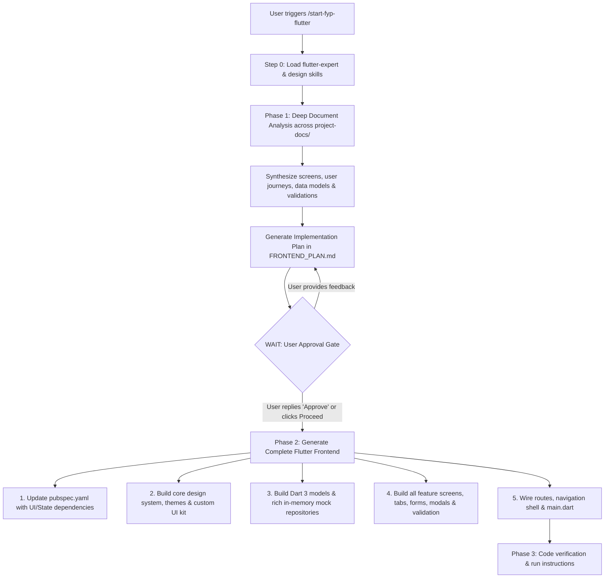

# Start FYP Flutter Skill (`/start-fyp-flutter`)

This skill is the single-command automation workflow for building complete Flutter mobile frontends from Final Year Project (FYP) documentation.

---

## ⚡ Trigger Command

Activate this skill when the user runs:
```
/start-fyp-flutter
```
*(Also activates if the user asks to start/build their Flutter FYP project from `project-docs`).*

---

## 🧠 Step 0: MANDATORY: Load All Installed Skills into Context

Before analyzing documents, structuring the architecture, formulating the plan, or generating any code, the agent **MUST** read and load all installed workspace skills using `view_file`:

1. **`flutter-expert`** ([`../flutter-expert/SKILL.md`](../flutter-expert/SKILL.md)):
   - Dart 3 patterns (records, pattern matching, sealed classes, strict null safety).
   - Widget tree optimization: `const` constructors, keys, slivers for large scrollable lists, avoiding unnecessary rebuilds.
   - State management: Clean Provider/ChangeNotifier, Riverpod 2.x, or BLoC repository patterns.
   - Impeller rendering optimization and 60/120fps smooth animations.
2. **`senior-architect`** ([`../senior-architect/SKILL.md`](../senior-architect/SKILL.md)):
   - System architecture, modular layer decoupling, data flow design.
   - System architecture diagrams with Mermaid for visual clarity in the plan.
   - Scalable folder organization and architectural trade-off evaluations.
3. **`ui-ux-pro-max`** ([`../ui-ux-pro-max/SKILL.md`](../ui-ux-pro-max/SKILL.md)):
   - Design intelligence: 50+ styles, 97 curated palettes, 57 font pairings.
   - Micro-animations, responsive layout rules, light and dark themes.
4. **`mobile-design`** ([`../mobile-design/SKILL.md`](../mobile-design/SKILL.md)):
   - Touch ergonomics: minimum 48x48dp touch targets, thumb zone reachability.
   - Mobile-first UX constraints, gesture handling, and platform conventions.

---

## 🔄 Two-Phase Workflow



---

## 📋 Phase 1: Deep Document Ingestion & Plan Creation

### Step 1.1: Deep Document Discovery & Verification
1. Check the documentation folder `project-docs/` at the workspace root using `list_dir`.
2. **Empty or Missing Folder Guard (Mandatory Check)**:
   - If `project-docs/` does not exist, or contains only `README.md`, or has no actual FYP project documents (such as SRS, requirements, architecture, wireframes, schemas):
   - **Immediately halt execution and notify the user with clear instructions:**
     > "The `project-docs/` directory is currently empty or does not contain any FYP documents. Please place your FYP project documents inside the `project-docs/` folder (supported formats: `.pdf`, `.docx`, `.md`, `.txt`, `.json`, `.sql`, or wireframe images), then run `/start-fyp-flutter` again to begin the deep analysis."
   - Do NOT guess or invent requirements without project documents. Stop and wait for user input.
3. If documents are present, recursively scan all subdirectories and read **EVERY** document in full using `view_file` (or text extraction tools for PDFs/docs).
3. Perform a **deep requirements breakdown**:
   - **App Domain & Objectives**: What real-world problem does this FYP solve? Who are the target stakeholders?
   - **User Personas & Roles**: Identify distinct roles (e.g., Patient vs. Doctor, Student vs. Instructor, Admin vs. Customer) and their screen access levels.
   - **Comprehensive Screen Inventory**: Catalog every screen, tab, drawer, modal, popup, and bottom sheet mentioned or implied in the documents.
   - **User Flow & Navigation Map**: Chart how a user navigates from splash -> onboarding -> auth -> dashboard -> deep feature screens -> profile.
   - **Form Fields & Validation Rules**: Extract all required inputs, email/phone regex, password requirements, number ranges, date pickers, and error states.
   - **Domain Data Entities**: Identify every model, its attributes, types, relationships, and status lifecycles.
   - **Visual Branding & Design Language**: Identify specified color accents, dark/light theme requirements, and typography.

### Step 1.2: Check Flutter Project Setup
- Inspect `pubspec.yaml` and `lib/` in the workspace to verify package name, SDK constraints, and folder layout.

### Step 1.3: Generate Deep Implementation Plan in FRONTEND_PLAN.md (Powered by All Skills)
1. Apply the combined intelligence of all loaded skills to plan every layer of the app:
   - **`senior-architect`**: Structure clean separation of concerns, define modular feature boundaries, and generate a clear Mermaid diagram illustrating data and navigation flow.
   - **`flutter-expert`**: Select the optimal state management strategy (Provider, Riverpod, or BLoC), define Dart 3 model architectures, and plan high-performance widget composition.
   - **`ui-ux-pro-max`**: Design an aesthetic color system (primary, secondary, surface, background hex codes), Google Fonts typography pairing, card elevations, and light/dark theme tokens.
   - **`mobile-design`**: Ensure mobile ergonomics, thumb zone navigation, minimum 48x48dp touch targets, and responsive padding.
2. Follow [references/plan-template.md](references/plan-template.md) and synthesize all extracted details.
3. The plan must contain:
   - **Executive Summary**: App scope, primary user roles, documents analyzed.
   - **Architecture Diagram**: Mermaid diagram produced via `senior-architect` guidelines.
   - **Exhaustive Screen-by-Screen Catalog**: Detail every UI view, its components, inputs, and actions.
   - **Data Models & Realistic Dummy Data Specifications**: Full Dart 3 data model schemas and realistic domain-specific mock records (refer to [references/dummy-data-patterns.md](references/dummy-data-patterns.md)).
   - **Design System Tokens**: Primary/secondary colors, light/dark themes, Google Fonts typography, card radiuses, and shadows.
   - **Architecture & State Management**: Architecture patterns following [`flutter-expert`](../flutter-expert/SKILL.md).
   - **Exact File Roadmap**: Comprehensive list of files to be generated under `lib/`.
4. Save the plan directly into the project root file:
   - Target File: `FRONTEND_PLAN.md` (at project root, never create artifact files as per Rule 9).
   - Record decision and status inside `AGENTS.md` (as per Rule 2).
5. Notify the user in the chat:
   - Summarize the discovered features, screen count, and architecture.
   - State clearly: **"Review the implementation plan saved in FRONTEND_PLAN.md. Reply with 'Approve' to start generating the complete Flutter frontend."**
   - **STOP HERE.** The agent MUST NOT write code until user approval is received.

---

## 🛑 The Approval Gate (MANDATORY HALT)

> [!IMPORTANT]
> **DO NOT generate any Flutter code before the user approves the plan.**
> If the user gives feedback or requests changes, update `FRONTEND_PLAN.md` and `AGENTS.md` first.
> Once the user replies with "Approve", "Proceed", "Looks good", or "start building", immediately execute Phase 2.

---

## 🚀 Phase 2: Autonomous Complete Frontend Generation

Once approved, autonomously build the full frontend codebase following [references/architecture-guide.md](references/architecture-guide.md) and [`flutter-expert`](../flutter-expert/SKILL.md).

### Step 2.1: Dependencies & Configuration
1. Update `pubspec.yaml` with essential UI and state management packages:
   - `google_fonts`, `intl`, `provider` (or `flutter_riverpod`), `flutter_svg`, `iconsax_flutter` (if applicable).
2. Run `flutter pub get` via `run_command`.

### Step 2.2: Design System & Core UI Kit (`lib/core/`)
1. `lib/core/constants/app_colors.dart`: Tailored color palette with Light and Dark variants.
2. `lib/core/constants/app_dimensions.dart`: Consistent spacing, radiuses, elevations.
3. `lib/core/theme/app_theme.dart`: Cohesive light and dark `ThemeData` (M3 styling).
4. `lib/core/widgets/`:
   - `custom_button.dart`: Primary, outlined, text, and loading state buttons.
   - `custom_text_field.dart`: Styled inputs with validation, clear buttons, and password obscure toggles.
   - `app_card.dart`: Styled surface cards with clean elevation or subtle borders.
   - `empty_state_view.dart`: Clean empty state with icon and action button.
   - `error_state_view.dart`: Error retry widget.
   - `loading_shimmer.dart`: Skeleton loader.

### Step 2.3: Data Models & Mock Repositories (`lib/data/`)
1. `lib/data/models/`: Dart 3 models with `copyWith`, `toJson`, and `fromJson`.
2. `lib/data/mock/`: Realistic, domain-authentic dummy datasets (10–15 rich records per feature, diverse avatars, realistic dates/prices/statuses).
3. `lib/data/repositories/`: In-memory mock repositories with:
   - Simulated latency: `await Future.delayed(const Duration(milliseconds: 350));`
   - In-memory state mutation (add, delete, update, toggle bookmark/favorite).
   - Real-time search and category filtering.

### Step 2.4: Feature Modules & Complete Screens (`lib/features/`)
Generate **EVERY** screen identified during Phase 1. Ensure zero empty placeholder screens:
1. **Authentication & Onboarding**:
   - Onboarding carousel with smooth indicators and skip/finish actions.
   - Login view with validation, remember me, and mock social buttons.
   - Registration view with multi-field validation.
   - Forgot password & mock OTP verification.
2. **Main Navigation Shell**:
   - Bottom navigation bar or navigation rail connecting all core tabs with active indicators and badges.
3. **Core FYP Features**:
   - Home Dashboard with greeting, key metric cards, banners, and recent activity.
   - List / Browse view with search bar, filter chips, and sorting modal sheet.
   - Detail view with hero imagery, metadata chips, expandable sections, and persistent action bar.
   - Create / Edit Form view with full validation and mock submission into the repository.
4. **Profile & Settings**:
   - User profile with stats, avatar, and menu items.
   - Live theme toggle (Dark / Light mode switch), notifications toggle, and About dialog.

### Step 2.5: Routing & Main App Entry (`lib/routes/` and `lib/main.dart`)
1. Create `lib/routes/app_routes.dart` and `lib/routes/app_router.dart`.
2. Update `lib/main.dart` with state providers, theme configuration, and root routing.

---

## 🔍 Phase 3: Verification & Execution Instructions

1. **Verify Code Integrity**: Check that imports are clean and syntax is valid.
2. **Walkthrough Presentation**:
   - Provide the user with a structured breakdown of all generated screens.
   - Provide direct instructions to run the application:
     ```bash
     flutter run
     ```
   - Highlight the interactive features they can test immediately (search, filter, create item, dark mode toggle, tab navigation).
