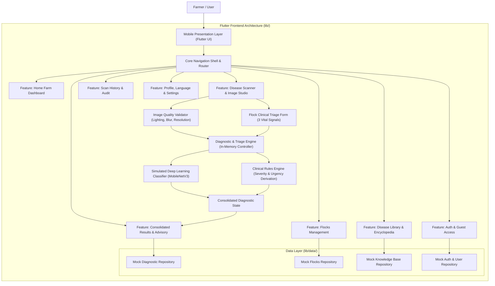

# PoultryCare: Flutter Frontend Implementation Plan
## Poultry Disease Detection & Severity Assessment Mobile Application

---

## 1. Executive Summary & Document Review

- **Project Title**: Poultry Disease Detection and Severity Assessment from Fecal Images (PoultryCare)
- **Institution**: Khwaja Fareed University of Engineering & Information Technology (KFUEIT), Rahim Yar Khan
- **Developers**: Isha Ishtiaq (COSC232101047), Maham Maqbool (COSC232101029)
- **Supervisor**: Dr. Shahzad Hussain
- **Project Domain**: Mobile Health Tech, Computer Vision for Poultry Agriculture, Clinical Triage and Biosecurity Advisory
- **Target Audience & Personas**:
  - **Smallholder Farmers (Primary)**: Non-technical rural farmers monitoring flocks, needing fast, visual, non-intimidating disease detection, instant severity assessment, and practical care steps.
  - **Veterinary Extension Personnel (Secondary)**: Field health technicians performing flock pre-screening, logging diagnoses, and validating treatment regimens.
  - **Agricultural Administrators**: Maintaining disease guidelines, monitoring regional disease drift, and reviewing model versions.
- **Documents Analyzed**:
  - `project-docs/FYP_PoultryDiseaseDetection_Documentation_with_Chapter5 (3).docx`
    - Chapter 1: Problem background, high mortality in poultry due to delayed fecal disease identification, project scope and objectives.
    - Chapter 3: Requirement engineering, 10 user needs (N-01 to N-10), 13 functional requirements (FR-01 to FR-13), 9 non-functional requirements (NFR-01 to NFR-09).
    - Chapter 4: System design, UML diagrams (Use Case, Class, Activity, Sequence, Component), Entity Relationship Diagram.
    - Chapter 5: Complete PostgreSQL relational schema, 10 database tables (`users`, `sessions`, `flocks`, `diseases`, `treatments`, `model_versions`, `scans`, `predictions`, `feedback`, `audit_logs`), enumerated types, write path of one diagnosis, bilingual support (English and Urdu), and audio guidance requirement.

---

## 2. System Architecture & Component Flow



---

## 3. Exhaustive Screen-by-Screen Catalog

### Phase A: Onboarding, Entry & Authentication
1. **Splash Screen (`lib/features/auth/views/splash_screen.dart`)**:
   - Animated emerald logo and leaf/poultry iconography.
   - Project title: "PoultryCare" with subtitle "AI-Powered Poultry Health & Triage".
   - Active model status indicator (e.g., `MobileNetV3 Active - v1.2.0`).
   - Auto-navigation to Onboarding or Dashboard.
2. **Onboarding Carousel (`lib/features/auth/views/onboarding_screen.dart`)**:
   - Slide 1: "Instant Dropping Diagnosis" (Capture or upload chicken fecal droppings for immediate AI detection).
   - Slide 2: "Clinical Severity & Flock Triage" (Assess Mild, Moderate, or Severe risks with flock symptom scoring).
   - Slide 3: "Vet-Backed Care & Biosecurity" (Actionable medications, isolation protocols, and bilingual audio advice).
   - "Skip" and "Get Started" actions with page indicator dots.
3. **Authentication & Guest Access (`lib/features/auth/views/login_screen.dart`, `register_screen.dart`)**:
   - Dual sign-in options: Email or Phone Number (designed for rural Pakistan smallholders).
   - Password field with toggle visibility.
   - "Continue as Guest" primary button: Zero-barrier guest scanning as explicitly required in Chapter 5.
   - Registration includes consent toggle: "Allow anonymized scan images for model retraining" (`consent_to_retain_images`).

### Phase B: Main Shell & Navigation
4. **Main Navigation Shell (`lib/features/home/views/main_shell_screen.dart`)**:
   - Modern Material 3 persistent bottom navigation bar with active badges.
   - 4 main navigation tabs:
     - Tab 0: Farm Dashboard (`Home`)
     - Tab 1: AI Diagnostics (`Scan`)
     - Tab 2: My Flocks (`Flocks`)
     - Tab 3: Disease Library (`Library`)
     - Tab 4: History & Account (`Profile`)

### Phase C: Core Features & Workflows
5. **Home Farm Dashboard (`lib/features/home/views/home_dashboard_screen.dart`)**:
   - Farmer greeting and active flock quick-switcher chip.
   - Prominent Emergency Outbreak Banner (Notifiable alerts e.g., "Newcastle Disease Alert in Region").
   - Primary CTA Card: "Start New Fecal Scan" with camera and gallery shortcuts.
   - Farm Vital Statistics Cards: Total Scans Conducted, Healthy Flocks Rate, Pending Treatments, Monitored Flocks.
   - Recent Diagnoses Feed: Mini preview cards showing timestamp, disease badge, and severity indicator.
   - Audio Tip of the Day card with playable audio simulation.
6. **AI Disease Scanner & Studio (`lib/features/scanner/views/scanner_screen.dart`)**:
   - Dual capture mode: Live Camera simulation and Gallery image selector.
   - Sample images selector: 4 ready-to-test realistic samples for instant demonstration (Coccidiosis, Newcastle Disease, Salmonella, Healthy).
   - Interactive Image Validation Panel (FR-11):
     - Lighting quality check (Adequate vs Dark).
     - Blur and sharpness detection indicator.
     - Single dropping focus validator.
   - 3-Question Clinical Flock Triage Modal/Step (FR-05, Chapter 5):
     - Question 1: Lethargy & Bird Count ("How many birds look droopy or sick? Single bird / Under 10% / Over 10%").
     - Question 2: Feed & Water Consumption ("Has feed or water intake decreased? Normal / Reduced / Severely dropped").
     - Question 3: Sudden Mortality ("Have any birds died in the last 24 hours? None / 1 to 2 birds / Multiple birds").
   - Inference Loading Overlay: Multi-stage progress indicator:
     - Step 1: Preprocessing & Normalization (FR-02)
     - Step 2: Deep Learning Inference (MobileNetV3)
     - Step 3: Rules Engine Triage Evaluation
7. **Consolidated Diagnostic Result Screen (`lib/features/scanner/views/diagnostic_result_screen.dart`)**:
   - FR-08 Compliance: Consolidated single-screen view containing all diagnostic parameters.
   - Fecal Scan Preview with timestamp, flock tag, and retake action.
   - Disease Detection Badge:
     - Coccidiosis (`coccidiosis`)
     - Newcastle Disease (`ncd`) - With high-priority blocking alert (FR-07, is_notifiable = true)
     - Salmonella (`salmonella`)
     - Healthy (`healthy`)
   - Model Confidence & Certainty Meter:
     - Calibrated confidence percentage (FR-04).
     - Certainty level: Confident, Uncertain, or Cannot Tell.
   - Derived Clinical Severity Level:
     - Mild (Yellow), Moderate (Orange), Severe (Red), or Healthy (Green).
   - Clinical Urgency Badge:
     - Monitor, Treat Today, Vet Soon, or Vet Now!
   - Bilingual Audio Narration Button (FR-09, Chapter 5):
     - English / Urdu spoken guidance simulation for farmers who prefer audio.
   - Structured Medical Treatment Guidance (FR-06, FR-07):
     - Recommended Medicines (e.g., Amprolium, Enrofloxacin, Multivitamins/Electrolytes) in English & Urdu.
     - Basic Care Steps (Step-by-step hydration, heat management, hygiene).
     - Biosecurity & Isolation Protocol (Shed isolation, disinfection, boot dip instructions).
     - Vet Consultation Warning Banner (explicit indicator if immediate vet is required).
   - Explainable AI Panel:
     - Transparent list of triage rules that fired (e.g., `["baseline_salmonella_moderate", "mortality_escalation_severe", "vet_now_triggered"]`).
   - Farmer Feedback & Vet Sign-Off Widget (Chapter 5):
     - Helpful toggle (Thumb Up / Down).
     - Vet Confirmation dropdown (Actual disease class if verified by veterinary professional).
     - Notes field and Submit action.
   - Quick Action Buttons in Thumb Zone:
     - "Retake / Scan Another" (FR-13).
     - "Save to Flock History".
     - "Share Diagnostic Summary".
8. **My Flocks Management (`lib/features/flocks/views/flocks_list_screen.dart`, `flock_detail_screen.dart`, `add_flock_dialog.dart`)**:
   - List of farm sheds/flocks (up to 20 flocks limit per user as defined in Chapter 5).
   - Flock card displaying: Name, Bird Count, Breed, Active Health Status, and Last Scan Date.
   - Add/Edit Flock form with full validation:
     - Flock Name (e.g., "Shed 1 - Broilers").
     - Number of birds (optional number field).
     - Breed (e.g., Cobb 500, Ross 308, Desi, Fayoumi).
     - Shed notes & vaccination records.
   - Flock Detail View: Complete timeline of past diagnostic scans specifically associated with this flock.
9. **Scan History & Audit Log (`lib/features/history/views/scan_history_screen.dart`, `scan_detail_modal.dart`)**:
   - Reverse chronological timeline of all scans (persisted for both guests on device and registered users).
   - Search bar and filtering chips (All, Coccidiosis, Newcastle, Salmonella, Healthy, Severe Only).
   - Tapping an item opens the complete historical diagnostic card with treatment notes and triage details.
10. **Poultry Disease Encyclopedia & Knowledge Base (`lib/features/encyclopedia/views/disease_library_screen.dart`, `disease_detail_screen.dart`)**:
    - Comprehensive guide to the 4 classes:
      - Coccidiosis: Protozoan parasite, bloody droppings, intestinal damage.
      - Newcastle Disease: Highly contagious paramyxovirus, green watery droppings, twisted neck, respiratory distress.
      - Salmonella (Pullorum / Fowl Typhoid): Bacterial infection, white chalky / yellowish vent pasting.
      - Healthy: Normal digestive physiology, firm texture with white urate cap.
    - Tabbed view: Clinical Signs, Prevention, Medicines by Severity, Emergency Contacts.
    - Bilingual toggle: Instant switch between English and Urdu.
11. **User Profile & Application Settings (`lib/features/profile/views/profile_screen.dart`, `settings_screen.dart`)**:
    - User account summary (Guest Mode vs Registered Farmer / Admin).
    - Language Selector: English vs Urdu (`locale: en | ur`).
    - Dark Mode / Light Mode Live Theme Switcher.
    - AI Model Registry Viewer (Chapter 5 `model_versions` table):
      - Model: MobileNetV3-Small (Poultry Fecal Backbone)
      - Active Version: `v1.2.0-quantized`
      - Macro F1: 94.6% | Balanced Accuracy: 94.1% | MCC: 0.92
    - Privacy & Temporary Cache Cleaner (FR-12):
      - "Clear temporary image cache now" button.
      - "Image retention consent" switch.
    - FYP Credits & KFUEIT Information:
      - Developers: Isha Ishtiaq & Maham Maqbool
      - Supervisor: Dr. Shahzad Hussain
      - Department of Computer Science, KFUEIT.

---

## 4. Data Models & Rich Mock Dataset Design

All models implemented in clean Dart 3 with null safety, `copyWith`, `toJson`, and `fromJson`.

| Model Name | Key Properties | Mock Count | Sample Record |
|---|---|---|---|
| `UserModel` | id, displayName, email, phone, role (`farmer` \| `admin`), locale (`en` \| `ur`), consentToRetainImages | 3 records | Maham Maqbool (Lead Farmer), Isha Ishtiaq (Admin), Guest Session |
| `FlockModel` | id, userId, name, birdCount, breed, notes, createdAt, activeStatus | 4 records | "Shed A (Broiler Batch 4) - 500 birds", "Shed B (Layers) - 250 birds" |
| `DiseaseModel` | code, nameEn, nameUr, summaryEn, summaryUr, signsEn, signsUr, baselineSeverity, baselineUrgency, isNotifiable, displayOrder | 4 records | `coccidiosis`, `ncd`, `salmonella`, `healthy` with full bilingual texts |
| `TreatmentModel` | id, diseaseCode, severity (`mild`, `moderate`, `severe`), medicinesEn, medicinesUr, careStepsEn, careStepsUr, biosecurityEn, biosecurityUr, vetRequired, urgency | 11 records | Complete clinical protocols for all valid (disease, severity) combinations |
| `ScanModel` | id, userId, deviceId, flockId, idempotencyKey, imageAssetPath, imageWidth, imageHeight, locale, createdAt | 8 records | Multi-day scans across various sheds with high-res poultry dropping images |
| `PredictionModel` | id, scanId, modelVersionId, predictedClass, probabilities, calibratedConfidence, certainty, conformalSet, abstained, abstainReason, energyScore, severity, urgency, triageRules, flockSignals, timingMs, createdAt | 8 records | Realistic predictions with confidence scores, severity rankings, and triage logs |
| `FeedbackModel` | id, scanId, wasHelpful, actualClass, confirmedByVet, comment, createdAt | 5 records | Realistic farmer feedback entries and vet confirmed cases |
| `ModelVersionModel` | id, version, source, backbone, macroF1, balancedAccuracy, mcc, isActive | 2 records | `v1.2.0-mobilenetv3` (Active) and `v1.1.0-resnet18` (Archived) |

---

## 5. Design System & Theming Specifications

### 5.1 Color Palette
- **Primary Brand Color**: Deep Emerald Forest (`#1B5E20` / `#2E7D32`) - Represents healthy livestock and farm vitality.
- **Primary Container**: Fresh Mint (`#E8F5E9` Light / `#1B382B` Dark).
- **Secondary / Accent**: Warm Harvest Amber (`#D97706` / `#F59E0B`) - For alerts, highlights, and poultry tags.
- **Background (Light)**: Clean warm off-white (`#F8FAFC`) to reduce outdoor sun glare.
- **Surface (Light)**: Pure White (`#FFFFFF`) with subtle border elevation (`#E2E8F0`).
- **Background (Dark)**: Deep Slate Navy (`#0F172A`).
- **Surface (Dark)**: Elevated Card Navy (`#1E293B`) with border (`#334155`).
- **Semantic Disease & Severity Colors**:
  - Healthy / Normal: Emerald Green (`#16A34A`)
  - Mild Severity: Amber Gold (`#EAB308`)
  - Moderate Severity: Vibrant Tangerine (`#EA580C`)
  - Severe / Newcastle Outbreak: Crimson Red (`#DC2626`)
  - Urgency "Vet Now": Deep Red Alert (`#991B1B`)

### 5.2 Typography
- **Primary Font**: Google Fonts `Plus Jakarta Sans` for modern legibility, crisp numbers, and strong hierarchy.
- **Urdu Font Pairing**: Clean Naskh/Nastaliq legible font styling for Urdu localization.
- **Body & Headings**: Generous line height (1.5) and minimum 16px body text for effortless reading on mid-range Android devices.

### 5.3 Mobile Touch Ergonomics
- Minimum touch target: 48x48dp for all buttons, chips, and list tiles.
- Thumb Zone placement: Primary actions (Take Photo, Select Image, Run Diagnosis, Retake) situated in bottom persistent bars and bottom sheets.
- No layout-shifting hover states or raw emojis as UI icons; standard crisp SVG / Material icons throughout.

---

## 6. Exact File Roadmap under `lib/`

```
lib/
├── core/
│   ├── constants/
│   │   ├── app_colors.dart             # Complete light & dark color palette
│   │   ├── app_dimensions.dart         # Margins, radiuses, elevations, touch sizes
│   │   ├── app_strings.dart            # English and Urdu UI strings
│   │   └── app_assets.dart             # Sample fecal images and icons
│   ├── theme/
│   │   ├── app_theme.dart              # ThemeData for Light and Dark modes
│   │   └── text_theme.dart             # Plus Jakarta Sans typography scale
│   ├── utils/
│   │   ├── formatters.dart             # Date, confidence percentage formatting
│   │   └── validators.dart             # Phone, email, and flock form validators
│   └── widgets/
│       ├── custom_button.dart          # Primary, Outlined, Loading state buttons
│       ├── custom_text_field.dart      # Standardized input fields with validation
│       ├── app_card.dart               # Elevated surface cards
│       ├── status_badge.dart           # Severity & disease colored badge chips
│       ├── audio_player_widget.dart    # Bilingual audio voice guide simulator
│       ├── empty_state_view.dart       # Graphic empty state placeholder
│       ├── error_state_view.dart       # Error recovery widget with retry
│       └── shimmer_loader.dart         # Skeleton loader for processing states
│
├── data/
│   ├── models/
│   │   ├── user_model.dart             # User & session entities
│   │   ├── flock_model.dart            # Farm flock entities
│   │   ├── disease_model.dart          # Disease master records (en/ur)
│   │   ├── treatment_model.dart        # Medical guidance & care steps
│   │   ├── scan_model.dart             # Scan image records
│   │   ├── prediction_model.dart       # AI prediction & triage records
│   │   ├── feedback_model.dart         # Farmer feedback & vet confirmation
│   │   └── model_version_model.dart    # AI model metadata
│   ├── mock/
│   │   ├── mock_users_data.dart        # Farmer and admin demo profiles
│   │   ├── mock_flocks_data.dart       # Realistic sheds and flocks
│   │   ├── mock_diseases_data.dart     # 4 classes with comprehensive en/ur content
│   │   ├── mock_treatments_data.dart   # 11 clinical protocols across severities
│   │   └── mock_scans_data.dart        # 8 historical scans with sample images
│   └── repositories/
│       ├── auth_repository.dart        # Guest bypass, login, user state
│       ├── flock_repository.dart       # Flock CRUD & count management
│       ├── disease_repository.dart     # Disease and treatment queries
│       └── diagnostic_repository.dart  # Inference simulator, triage rules engine, scan log
│
├── features/
│   ├── auth/
│   │   ├── controllers/
│   │   │   └── auth_controller.dart    # User session state & consent
│   │   └── views/
│   │       ├── splash_screen.dart      # Branding & model initialization
│   │       ├── onboarding_screen.dart  # 3-step value walkthrough
│   │       ├── login_screen.dart       # Email/phone login & guest action
│   │       └── register_screen.dart    # Account creation & consent toggle
│   ├── home/
│   │   ├── controllers/
│   │   │   └── dashboard_controller.dart
│   │   └── views/
│   │       ├── main_shell_screen.dart  # Persistent bottom navigation shell
│   │       └── home_dashboard_screen.dart # Stats, quick scans, outbreak banner
│   ├── scanner/
│   │   ├── controllers/
│   │   │   └── scanner_controller.dart # Image validation, 3 flock questions, inference
│   │   └── views/
│   │       ├── scanner_screen.dart     # Image picker, quality validator, flock triage
│   │       └── diagnostic_result_screen.dart # Consolidated diagnosis, treatment, feedback
│   ├── flocks/
│   │   ├── controllers/
│   │   │   └── flock_controller.dart   # Manage farm flocks
│   │   └── views/
│   │       ├── flocks_list_screen.dart # List of sheds with status
│   │       ├── flock_detail_screen.dart # Flock info & scan timeline
│   │       └── add_flock_modal.dart    # Add/edit flock dialog
│   ├── history/
│   │   ├── controllers/
│   │   │   └── history_controller.dart # Filter & search scan records
│   │   └── views/
│   │       └── scan_history_screen.dart# Filterable history archive
│   ├── encyclopedia/
│   │   └── views/
│   │       ├── disease_library_screen.dart # 4 diseases overview
│   │       └── disease_detail_screen.dart  # Clinical signs, treatments, audio
│   └── profile/
│       ├── controllers/
│       │   └── settings_controller.dart# Language (en/ur), Dark mode, Cache
│       └── views/
│           ├── profile_screen.dart     # Account info, stats, settings links
│           └── settings_screen.dart    # Theme toggle, Urdu switch, Model registry, About
│
├── routes/
│   ├── app_routes.dart                 # Route names constants
│   └── app_router.dart                 # Declarative onGenerateRoute setup
│
├── app.dart                            # MaterialApp setup with theme & locale
└── main.dart                           # Entry point with initialized Providers
```

---

## 7. Approval Gate

> [!IMPORTANT]
> **Please review this implementation plan.**
> If the structure, screens, and features match your project vision, reply with **"Approve"** (or click Proceed) to start generating the complete Flutter frontend immediately. If you have any suggestions or requests for changes, please share them!
